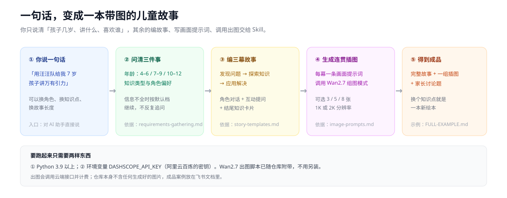
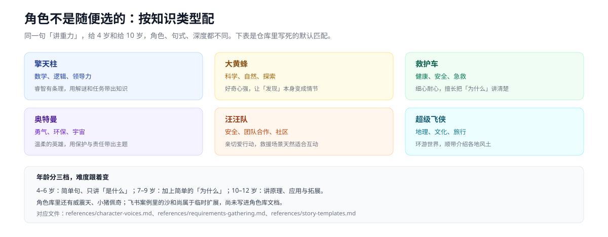
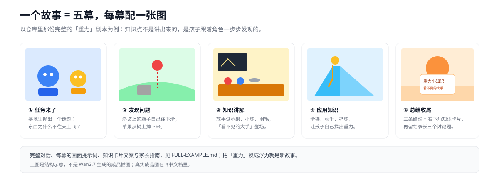
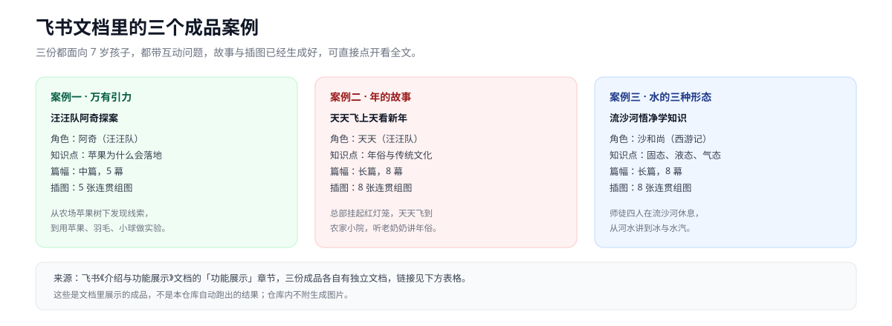

# 把知识讲成孩子爱听的故事：变形金刚儿童知识讲解员

   

## [👉 先看飞书文档里的三个成品故事（含截图）↗](https://vcnqyg6spyqg.feishu.cn/docx/DvxgdZFOhoVVEWxAU1scxA0cnze)

[](images/01-overview.svg)

**一句话**：对孩子说「用汪汪队讲讲苹果为什么会落地」，它会变成有角色、有对话、有插图、有提问的完整故事。
这是一份给 AI 助手用的 Skill，面向 4–12 岁孩子；变形金刚、奥特曼、汪汪队、超级飞侠都能来讲课，插图由 Wan2.7 生成。

[从哪里开始读](#从哪里开始阅读) · [看案例](#三个成品案例) · [怎么跑](#怎么跑) · [数字口径](#数字与口径) · [还差什么](#已知边界)

---

## 从哪里开始阅读

| 你现在想干什么 | 直接看这里 |
|---|---|
| 先看它到底能做出什么 | [飞书介绍文档](https://vcnqyg6spyqg.feishu.cn/docx/DvxgdZFOhoVVEWxAU1scxA0cnze) → [三个成品案例](#三个成品案例) |
| 想马上试一句 | [怎么跑](#怎么跑) → [快速参考卡](QUICKSTART.md) |
| 想看一份完整剧本 | [完整示例：讲重力](FULL-EXAMPLE.md) → [一个故事长什么样](#一个故事长什么样) |
| 想改角色、模板、提示词 | [角色怎么配](#角色怎么配) → [SKILL.md](SKILL.md) → [角色语气指南](references/character-voices.md) |
| 想知道哪些还没做 | [三个核心设计](#三个核心设计) → [已知边界](#已知边界) |

## 这是什么问题

给孩子讲知识，最难的不是「讲得对」，是「他愿意听」。直接说重力是万有引力，孩子三秒就走神；
但如果阿奇拿着放大镜追查「苹果为什么掉下来」，他会跟着一路问下去。

| 常见的麻烦 | 这份 Skill 怎么处理 |
|---|---|
| 不知道几岁该讲多深 | 年龄分 4–6 / 7–9 / 10–12 三档，句式和深度跟着变 |
| 不知道哪个角色适合哪个知识点 | 角色与知识类型有默认匹配表，见 [角色怎么配](#角色怎么配) |
| 故事和插图对不上，每张图角色都长得不一样 | 每幕写一条画面提示词，用 Wan2.7 的连贯组图模式一次出 3 / 5 / 8 张 |

## 角色怎么配

[](images/02-roles.svg)

默认匹配写在 `SKILL.md` 和 `references/requirements-gathering.md` 里；角色的说话方式单独放在 `references/character-voices.md`，
改角色不用动故事框架。四套故事模板（解谜、探险、救援、穿越）在 `references/story-templates.md`。

## 一个故事长什么样

[](images/04-story.svg)

`FULL-EXAMPLE.md` 里有一份 7 岁、讲重力、5 幕 5 图的完整剧本：每幕的场景、角色对话、画面提示词、
结尾的知识卡片、给家长的三个讨论题都写全了。把「重力」换成「浮力」或「水的三态」就是新故事。

## 三个成品案例

[](images/03-cases.svg)

下面三份是**飞书介绍文档里已经做好的成品**，都面向 7 岁孩子、都带互动问题，点开能看到故事全文和生成图：

| 案例 | 年龄 / 篇幅 / 插图 | 成品文档 |
|---|---|---|
| 汪汪队阿奇探案：万有引力的秘密 | 7 岁 · 中篇 5 幕 · 5 张 | [打开](https://www.feishu.cn/docx/FevPdRtynox5r9x0h64cBBqZnrd) |
| 天天飞上天看新年：年的故事 | 7 岁 · 长篇 8 幕 · 8 张 | [打开](https://www.feishu.cn/docx/FMAHdiHtWoFbKhxhpGDcjK5Lnyh) |
| 流沙河悟净学知识：水的三种形态 | 7 岁 · 长篇 8 幕 · 8 张 | [打开](https://www.feishu.cn/docx/DFdVdykJnoKlbJxfKZbcPxdAnKc) |

案例取自飞书《[介绍与功能展示](https://vcnqyg6spyqg.feishu.cn/docx/DvxgdZFOhoVVEWxAU1scxA0cnze)》的「功能展示」章节；
文档里还贴了当时的 Wan2.7 提示词原文。**本仓库不附这些生成图片**，也不声称它们由本仓库脚本自动重跑过。

## 三个核心设计

1. **角色驱动**：按年龄和知识类型选角色，每个角色有自己的说话方式。**没有**做过儿童学习效果测评。
2. **故事模板化**：三幕结构、四套模板、每幕一张图、结尾知识卡片。**没有**语音朗读、动画或视频。
3. **组图生成**：集成 Wan2.7，一次出 3 / 5 / 8 张连贯插图。**没有**内置图片存储，也**没有**自动排版成飞书文档的脚本。

## 怎么跑

需要 Python 3.9 以上，以及阿里云百炼的 `DASHSCOPE_API_KEY`；出图会调用云端接口并计费。

```bash
git clone https://github.com/fqyy360t/transformers-kid-educator-skill.git
export DASHSCOPE_API_KEY="你的密钥"
```

接着二选一：把 SKILL.md 交给支持 Skill 的 AI 助手，直接说「用汪汪队给我 7 岁孩子讲万有引力」；
或者复制 [QUICKSTART.md](QUICKSTART.md) 里五条现成的组图命令之一（浮力、重力、宇宙、交通安全都有），
改掉 `--user_requirement` 就能用。`scripts/generate_story_images.py` 是同一条链路的桥接脚本。

## 数字与口径

| 数字 | 口径（范围 / 分母） | 来源 |
|---|---|---|
| 3 / 5 / 8 张图 | 快速参考卡里 5 条命令使用的 `--n` 取值，不是接口全部可选值 | [QUICKSTART.md](QUICKSTART.md) |
| 4 套故事模板 | 模板库里 4 个模板章节：解谜、探险、救援、穿越 | [story-templates.md](references/story-templates.md) |
| 3 档年龄 | 4–6 / 7–9 / 10–12 岁，各自规定句式、深度、节奏 | [requirements-gathering.md](references/requirements-gathering.md) |
| 6 个默认角色 | 角色匹配表的 6 行；角色库另含威震天、小猪佩奇 | [SKILL.md](SKILL.md) |
| 3 个成品案例 | 飞书介绍文档「功能展示」章节的 3 份独立成品文档，都是 7 岁 | [飞书文档](https://vcnqyg6spyqg.feishu.cn/docx/DvxgdZFOhoVVEWxAU1scxA0cnze) |

这些数字来自仓库文件与飞书文档。**这次只做了文档整理，没有重新调用 Wan2.7 出图验证**，别把它们当成新跑出来的实验结果。

## 已知边界

- **不配密钥一定出不了图**：`DASHSCOPE_API_KEY` 为空时桥接脚本只给警告，真正请求会失败；离线状态下只能拿到故事文本和提示词。
- **成品图不在仓库里**：三份案例的插图在飞书文档中，文档属于个人租户，未登录可能打不开。
- **自动排版飞书文档没有实现**：飞书介绍里展示过「故事＋图片自动排版成文档」的效果，本仓库没有对应脚本，需要你用的 AI 工具自己完成。
- **角色库没跟上案例**：西游记的沙和尚出现在案例三，但没有写进 `references/character-voices.md`。
- **许可证文件缺失**：README 历史版本写过 MIT，仓库里**没有** `LICENSE` 文件，正式开源前需要补一份。
- **第三方脚本保留上游原样**：`wan2.7-image-skill/scripts/` 的代码与版权头未改动，只把配套说明文档翻成中文。

## 仓库结构

| 路径 | 干什么用 |
|---|---|
| `SKILL.md` | Skill 主定义：工作流程、角色库、知识分类、三种用法、常见问题 |
| `QUICKSTART.md` | 5 条可直接复制的组图命令，附改知识点 / 角色 / 数量的技巧 |
| `FULL-EXAMPLE.md` | 一份 5 幕「重力」完整剧本，含提示词、知识卡片、家长指南 |
| `references/` | 4 份参考：角色语气、画面提示词、需求收集、故事模板 |
| `scripts/generate_story_images.py` | 检查环境并调用 Wan2.7 的桥接脚本 |
| `wan2.7-image-skill/` | 随仓库附带的出图脚本与说明文档（第三方代码） |
| `images/` | 本页 4 张中文示意图 |
| `README_CN.md` | 历史中文版入口，现已合并到本文件 |

## 常见问题

| 现象 | 按顺序检查 |
|---|---|
| 提示没设置 `DASHSCOPE_API_KEY` | 先设环境变量；桥接脚本只警告不拦，真正调用会失败 |
| 任务一直是 `RUNNING` | 用 `check_wan_task_status.py` 查 `task_id`；SKILL.md 建议每 10 秒查一次、最多 3 次 |
| 组图里角色长得不一样 | 确认加了 `--enable_sequential`，且每条提示词都重复写了角色造型 |
| 想改角色说话的味儿 | 改 `references/character-voices.md`，别只改故事正文 |
| 提示词里画面太吓人 | 模板要求「儿童友好、无恐怖元素、无战斗场景」，检查是否被改写掉 |
| 旧链接指向 `README_CN.md` | 那份已合并到本文件，内容以这里为准 |
| 找不到 `LICENSE` | 仓库确实没有，见 [已知边界](#已知边界) |

## 想继续改

从 [SKILL.md](SKILL.md) 的工作流程开始；加角色改 `references/character-voices.md` 和 `image-prompts.md`，
加故事模板改 `references/story-templates.md`。飞书介绍文档里的三份成品可以直接拿来当提示词样例。

> 个人整理项目，动画角色形象归各自版权方所有；生成图片前请确认你使用的模型和素材符合相应条款。
