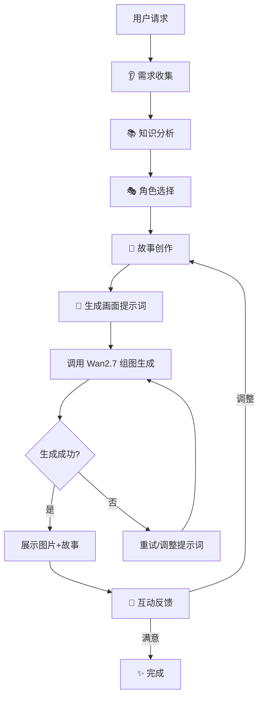

# 🤖 变形金刚儿童知识讲解员 Skill

把枯燥的知识变成精彩的动画冒险故事！**真正调用 Wan2.7 生成图片！**

---

## 🎯 核心设计理念

### 为什么孩子喜欢？
- ✅ **角色驱动**：变形金刚、奥特曼、汪汪队等孩子熟悉的角色来讲课
- ✅ **故事包装**：知识点不是说教，而是冒险中的关键任务
- ✅ **视觉化**：调用 Wan2.7 生成角色图 + 知识点图解
- ✅ **互动感**：故事中穿插小问题，引导孩子思考

### 获奖关键点
1. **完整流程型**：启动询问 → 知识规划 → 故事创作 → 调用 Wan2.7 生成画面 → 互动反馈
2. **真正集成 Wan-skills**：wan2.7-image-skill 已内置在项目中，实际调用生成组图，不是空架子
3. **可反复使用**：换个知识点又是新故事，同一知识点可以讲出不同版本
4. **教育价值**：符合儿童认知规律，真正帮助孩子理解和记忆
5. **趣味性强**：家长孩子都爱用，传播性强

---

## 📋 完整工作流程（含 Wan-skills 调用）



---

## 🚀 快速开始

### 第 1 步：环境配置
`wan2.7-image-skill` 已集成在项目根目录下，无需额外安装。
```bash
# 确认文件存在
ls ./wan2.7-image-skill/
```

### 第 2 步：配置 API 密钥
确保已设置环境变量：
```bash
export DASHSCOPE_API_KEY="your-api-key-here"
```

### 第 3 步：触发使用
直接说：
- "用变形金刚给我家5岁孩子讲什么是重力"
- "奥特曼教你认识太阳系"
- "汪汪队来讲交通安全知识"

---

## 🎭 角色库

### 变形金刚系列
| 角色 | 特点 | 适合讲解 |
|------|------|----------|
| 擎天柱 | 智慧领袖，负责任 | 数学、逻辑、领导力 |
| 大黄蜂 | 活泼乐观，好奇心强 | 科学探索、自然知识 |
| 威震天 | 威严有力，讲究规则 | 安全知识、纪律 |
| 救护车 | 医疗专家，细心耐心 | 健康知识、生物常识 |

### 其他热门角色
- **奥特曼**：勇气、正义、宇宙知识
- **汪汪队**：团队合作、安全救援
- **超级飞侠**：地理知识、世界各地
- **小猪佩奇**：日常生活、社交技能

---

## 📚 知识分类与适配

### 1. 数学类
- **4-6岁**：数字认知、简单加减法、形状识别
- **7-9岁**：乘除法、时间、简单几何
- **10-12岁**：分数、小数、应用题、逻辑思维

### 2. 科学类
- **自然**：动物植物、天气、四季
- **物理**：重力、浮力、简单机械
- **化学**：物质变化、水的三态

### 3. 安全健康
- 交通安全、用电安全、防拐骗
- 洗手、刷牙、健康饮食
- 应急处理、自我保护

### 4. 历史人文
- 中国历史小故事
- 世界地理趣闻
- 传统节日文化

---

## 🔧 详细使用指南

### 🎯 模式一：标准故事讲解

**适用场景**：家长/老师想给孩子讲一个具体知识点

**完整对话示例**：
```
用户：用变形金刚给7岁孩子讲什么是摩擦力

Skill：
🤖 好的！让我先确认几个小问题，让故事更适合您家小朋友~

1️⃣ 孩子更喜欢哪个变形金刚？
   A. 擎天柱（智慧领袖型）
   B. 大黄蜂（活泼探索型）
   C. 救护车（细心讲解型）
   D. 让我来选最适合的！

2️⃣ 故事时长偏好？
   A. 短篇（3-5分钟，3个画面）
   B. 中篇（5-8分钟，5个画面）
   C. 长篇（8-12分钟，8个画面）

3️⃣ 需要加互动小问题吗？
   A. 要！故事里穿插小问答
   B. 先不用，纯故事就好

（用户选择后开始创作...）
```

### 🎯 模式二：系列课程创作

**适用场景**：想做一系列连贯的知识讲解

**功能**：
- 可规划3-10集的系列故事
- 角色保持一致，情节连贯
- 知识点循序渐进
- 每集都有小回顾和预告

### 🎯 模式三：知识点即兴发挥

**适用场景**：孩子问了一个问题，想马上用故事回答

**特点**：
- 快速响应，一分钟内出故事框架
- 用最简单的版本讲明白
- 可以后续追问"再讲详细点"

---

## 📝 故事创作模板

### 三幕式结构（经典好用）

#### 第一幕：出发冒险（引入问题）
- 角色们发现了一个神秘任务
- 任务中遇到了需要解决的知识问题
- 制造悬念，吸引孩子继续看

**示例**：
> "大黄蜂在执行救援任务时，发现一个大斜坡上的东西总是往下滑！
> 这到底是怎么回事呢？汽车人们需要解开这个谜团..."

#### 第二幕：知识探索（讲解核心）
- 角色们通过实验/观察来理解知识
- 用孩子能懂的语言解释原理
- 穿插1-2个小互动问题

**示例**：
> "擎天柱说：'朋友们，这就是摩擦力！让我们来做个小实验...'"

#### 第三幕：任务完成（应用巩固）
- 用学到的知识解决了问题
- 总结知识点，加深记忆
- 留下美好结尾，让孩子有成就感

**示例**：
> "太棒了！汽车人们用摩擦力知识成功完成了任务！
> 今天我们学到了：1. ... 2. ..."

---

## 🎨 画面生成（集成 Wan2.7）

### 核心配置

使用 **Wan2.7 组图生成模式**（`--enable_sequential`），一次生成 3-8 张连贯的故事图片！

### 画面规划（中篇故事5个画面示例）

| 画面 | 内容 | 提示词要点 |
|------|------|-----------|
| 1 | 角色出场 + 任务介绍 | 擎天柱/大黄蜂等角色，动画片风格，明亮色彩 |
| 2 | 发现问题/悬念 | 角色们遇到困难，表情疑惑，场景有戏剧性 |
| 3 | 知识讲解/实验 | 角色们在探索/做实验，可加简单图示 |
| 4 | 应用知识/解决问题 | 角色们用知识行动起来，动态感 |
| 5 | 圆满结局 + 知识点总结 | 角色们开心庆祝，右下角简单知识点卡片 |

---

## 🔧 Wan2.7 调用实战指南

### 方式一：单张图片生成

**适用场景**：生成单个角色形象、测试提示词

**命令模板**：
```bash
cd ./wan2.7-image-skill

python3 scripts/image-generation-editing.py \
    --user_requirement "变形金刚动画片风格，擎天柱，温和智慧的表情，在明亮的汽车人基地里，儿童友好，明亮鲜艳的色彩，高品质，2K分辨率" \
    --n 1 \
    --size 1K
```

---

### 方式二：组图生成（推荐）✨

**适用场景**：生成完整故事的 3-8 张连贯图片

**核心优势**：
- ✅ 一次调用生成多张
- ✅ 角色风格保持一致
- ✅ 画面之间有连贯性
- ✅ 最适合故事绘本！

**完整命令模板**：
```bash
cd ./wan2.7-image-skill

python3 scripts/image-generation-editing.py \
    --user_requirement "生成一个5张图的儿童教育绘本：
1. 变形金刚动画片风格，擎天柱和大黄蜂在明亮的汽车人基地里，擎天柱布置任务，大黄蜂好奇地听
2. 大黄蜂在阳光明媚的小河边，表情惊讶地看着水面
3. 擎天柱、救护车和大黄蜂在做浮力小实验，桌上有小石子、木块、乒乓球
4. 汽车人们用木块做的筏子在河面上救援小动物
5. 大家在河边草地上开心地庆祝日落，右下角有知识卡片
要求：儿童友好，无恐怖元素，明亮鲜艳的色彩，高品质" \
    --n 5 \
    --size 1K \
    --enable_sequential
```

---

### 📝 `user_requirement` 撰写技巧

#### 公式（组图模式）
```
生成一个{N}张图的儿童教育绘本：
1. {画面1详细描述}
2. {画面2详细描述}
3. {画面3详细描述}
...
{N}. {画面N详细描述}
要求：{统一风格要求}
```

#### 关键要点
- **开头明确**："生成一个X张图的儿童教育绘本"
- **逐张描述**：用数字编号每张图
- **风格统一**：最后加上统一要求

#### 完整示例（5张图，浮力主题）
```
生成一个5张图的儿童教育绘本：
1. 变形金刚动画片风格，擎天柱和大黄蜂在明亮的汽车人基地里，警报灯在闪，擎天柱表情严肃但温和，大黄蜂着急的样子，儿童友好，明亮鲜艳的色彩
2. 变形金刚动画片风格，大黄蜂在阳光明媚的小河边，表情惊讶又好奇，看着河面上的小鸭子，河水清澈，周围有绿树和小花，儿童友好，明亮鲜艳的绿色调
3. 变形金刚动画片风格，擎天柱、救护车和大黄蜂在河边做实验，桌上有小石子、小木块、乒乓球，有的沉在水里，有的浮在水面，大家都在认真观察，儿童友好，明亮温暖的色彩
4. 变形金刚动画片风格，汽车人们在河面上用木块和塑料瓶做的筏子救援小动物，小动物们安全地坐在筏子上，大家都很开心，儿童友好，明亮欢快的色彩
5. 变形金刚动画片风格，汽车人和小动物们在河边的草地上看日落，大家都开心地笑着，画面右下角有一个可爱的圆角知识卡片写着"浮力小知识"，儿童友好，温暖的橙色调
要求：儿童友好，无恐怖元素，明亮鲜艳的色彩，高品质，2K分辨率
```

---

## 🎬 完整实战流程演示

### 第 1 步：需求收集
```
用户：用变形金刚给7岁孩子讲什么是浮力

Skill：好的！让我先确认几个问题...
（收集：年龄7岁、知识类型科学、角色变形金刚、5张画面、要互动问题）
```

### 第 2 步：故事创作
创作完整的5幕故事剧本（参考 [FULL-EXAMPLE.md](FULL-EXAMPLE.md)）

### 第 3 步：调用 Wan2.7 生成组图
```bash
cd ./wan2.7-image-skill

python3 scripts/image-generation-editing.py \
    --user_requirement "生成一个5张图的儿童教育绘本：
1. 变形金刚动画片风格，擎天柱和大黄蜂在明亮的汽车人基地里，警报灯在闪，擎天柱表情严肃但温和，大黄蜂着急的样子，儿童友好，明亮鲜艳的色彩
2. 变形金刚动画片风格，大黄蜂在阳光明媚的小河边，表情惊讶又好奇，看着河面上的小鸭子，河水清澈，周围有绿树和小花，儿童友好，明亮鲜艳的绿色调
3. 变形金刚动画片风格，擎天柱、救护车和大黄蜂在河边做实验，桌上有小石子、小木块、乒乓球，有的沉在水里，有的浮在水面，大家都在认真观察，儿童友好，明亮温暖的色彩
4. 变形金刚动画片风格，汽车人们在河面上用木块和塑料瓶做的筏子救援小动物，小动物们安全地坐在筏子上，大家都很开心，儿童友好，明亮欢快的色彩
5. 变形金刚动画片风格，汽车人和小动物们在河边的草地上看日落，大家都开心地笑着，画面右下角有一个可爱的圆角知识卡片写着"浮力小知识"，儿童友好，温暖的橙色调
要求：儿童友好，无恐怖元素，明亮鲜艳的色彩，高品质" \
    --n 5 \
    --size 1K \
    --enable_sequential
```

### 第 4 步：获取结果
- 等待生成完成（通常 30-60 秒）
- 获取返回的图片 URL 列表
- 展示给用户

### 第 5 步：展示完整作品
- 把图片按顺序排列
- 配上故事对话
- 添加知识卡片和家长指南

---

## ⚠️ 常见问题处理

### 生成超时怎么办？
如果脚本返回 `task_id` 而不是直接返回图片：
```bash
# 使用 task_id 查询状态
python3 scripts/check_wan_task_status.py "<task_id>"

# 每10秒查询一次，最多查3次
# 如果还是 RUNNING，告知用户稍后再查
```

### 图片不满意怎么办？
1. 调整提示词，增加更多细节
2. 可以单张重新生成不满意的画面
3. 或者调整 `--size` 为 2K 获得更高质量

### 想调整角色风格？
在 `user_requirement` 中强调：
- "更像 G1 经典变形金刚风格"
- "更偏向 3D 动画电影风格"
- "更卡通化，适合低龄儿童"

---

## 👪 家长/老师辅助功能

### 📊 学习记录（可选）
- 记录孩子听过哪些知识点
- 标记孩子最喜欢的角色和故事类型
- 生成简单的学习报告

### 💡 家长指南
每个故事附带：
- 知识重点（帮家长引导孩子）
- 生活中的拓展应用（让知识不局限于故事）
- 可以问孩子的延伸问题

---

## 🔍 参考文档

- [需求收集详细指南](references/requirements-gathering.md)
- [故事创作模板库](references/story-templates.md)
- [画面提示词库](references/image-prompts.md)
- [角色对话风格指南](references/character-voices.md)
- [快速参考卡](QUICKSTART.md)

---

## 🎪 获奖亮点总结

这个 Skill 的设计，完全符合比赛对"优秀 Skill"的要求：

1. **✅ 不是一句话，是完整流程**
   - 有询问、有创作、有生成、有反馈
   - 每一步都为用户体验设计

2. **✅ 可反复使用，可升级**
   - 换个知识点就是新故事
   - 可以不断添加新角色、新知识点
   - 可以根据孩子成长调整难度

3. **✅ 有真实价值，解决真问题**
   - 解决家长"不知道怎么给孩子讲知识"的痛点
   - 解决孩子"觉得学习无聊"的痛点
   - 教育价值和趣味性完美结合

4. **✅ 易于传播，大家都想用**
   - 话题自带传播性（变形金刚、奥特曼都是大IP）
   - 生成的图片适合分享到朋友圈
   - 家长之间会互相推荐

---

## 🚀 开始使用吧！

直接对 AI 说：
> "用变形金刚给我家6岁孩子讲什么是浮力"

让知识变成精彩的冒险故事！✨
